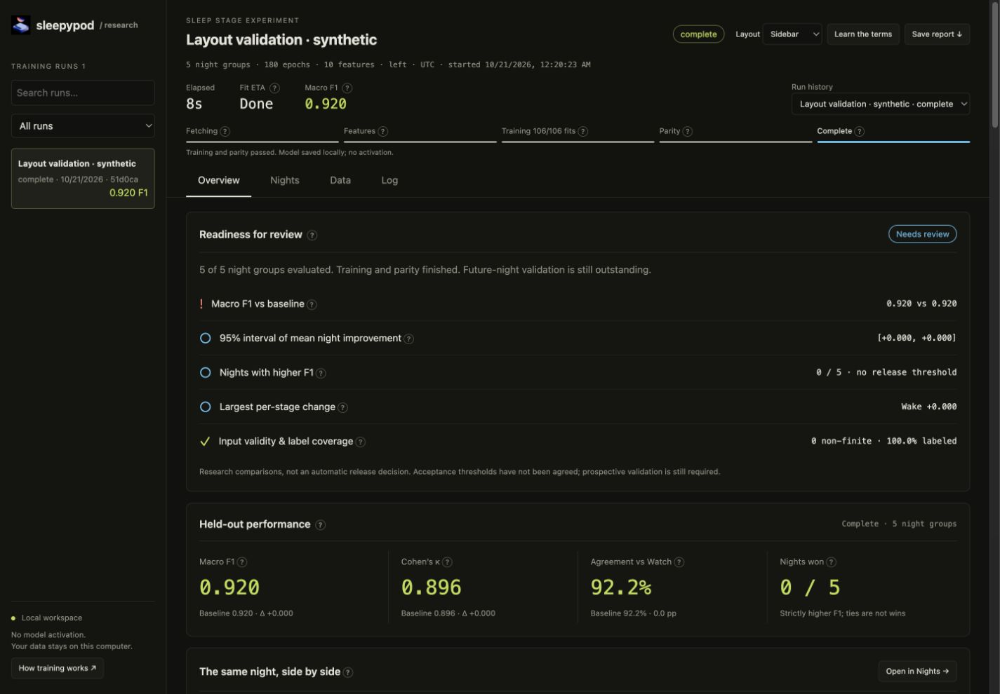
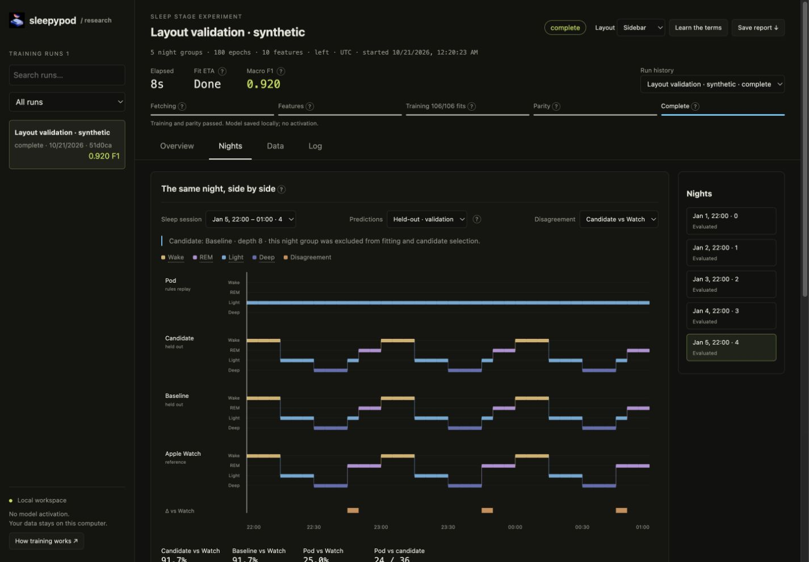

# Training

`sleepypod/training` — offline sleep-stage model training and an
[OKF knowledge base](knowledge/index.md). Available publicly at
[sleepypod/training](https://github.com/sleepypod/training).

## Training workspace

Watch training progress, compare held-out models with the pod rules and Watch
labels, and reopen previous runs. See the [sleepypod documentation](https://sleepypod.github.io/developers/training/)
for the workflow and how it relates to personal models on the pod.





These are unmodified captures of the running app with deterministic synthetic
test data. The displayed scores illustrate the interface, not real-world accuracy.

## Setup

Install Node.js 24 and `uv`, then from this repository:

```sh
npm ci
uv sync --locked
```

`package-lock.json` pins the TypeScript tooling and SQLite dependency. `uv.lock`
pins Python 3.11 numerical dependencies. Production features, rules, and portable
inference are [vendored from a pinned core revision](vendor/README.md), with checksums;
no sibling core checkout or unpublished commit is needed to run training.

## Query the pod and watch training

```sh
uv run --locked python scripts/train.py --pod 192.168.1.88 --side left --dashboard --verbose
```

Replace the example IP with your pod. The fetcher uses unauthenticated, read-only
HTTP on port 3000; `--pod hostname:port` also works. It reads the pod timezone,
completed sessions from the last 30 days, vitals, movement, imported Watch labels,
and the current stage rules. Use `--days 14` to change the window or `--timezone`
to explicitly override the pod setting. No MCP client or SSH is needed.

If Watch labels are not already imported on the pod, add
`--watch-export data/export.zip` or `--watch-json data/watch.json`. Fetching does
not import labels, modify settings, or activate a model.

Terminal progress shows each phase, completed night folds, model fits, and elapsed
time. `--verbose` keeps every event on its own terminal line. All runs also save
`events.jsonl` with the complete structured history. The dashboard shows:

- Response-body bytes, average download throughput, API calls, and unique input rows.
- Labeled/unlabeled feature epochs, class balance, and per-feature min/mean/max/std.
- Per-fit input rows (before/after oversampling), fit time, rows/s, and actual tree/node counts.
- A fit-time chart and per-night held-out macro F1 for nested selection versus the baseline.
- A scrolling activity feed with inner-validation scores and current evaluation phase.

Throughput measures wall-clock work for this run, not sensor cadence. Feature
matrix bytes describe float64 storage, not process memory. Per-night scores are
not a loss/learning curve, and partial results are not a final quality estimate.
Dashboard history is bounded (120 events, 80 fit timings); `events.jsonl` retains
all events. Feature summaries are descriptive only and do not affect fitting.
 `--dashboard` prints a loopback URL for a live browser view with progress,
model comparisons, selectable metrics, and confusion matrices. The sleep comparison
at the top aligns Pod / New model / Apple Watch stages by session. Select a night,
hover an interval, or use Previous/Next to inspect exact stages. Orange marks
Pod/model disagreements. Held-out predictions appear as each night finishes;
the final fitted-model view is explicitly in-sample. It stays open after
training until Ctrl-C. Without this flag the command exits when training finishes.
Both modes save `index.html` in the run directory; open it directly for an offline
interactive report. A failed or interrupted run retains its status and partial
files; retry into a new directory.

API reads are not an atomic database snapshot. The fetcher limits acquisition to
completed sessions, splits saturated API windows, checks side identity, detects
configuration/calibration changes, and retains response hashes in
`acquisition.json`. Concurrent historical backfills can still alter data between
reads. Use a consistent SQLite backup when atomic input consistency is required.
Timeline Pod stages come from `GET /api/biometrics/sleep-stages` for each record,
with record identity and stage-view consistency checked. The five-minute comparison
samples pod/Watch stages at epoch midpoints; it does not display their original
sub-epoch boundaries. Snapshot-only runs label the pod lane as a local rules replay.
Aggregate “Rules (replay)” metrics still use the pinned local rules engine.
The current rules are applied retrospectively; they do not reconstruct historical
per-sample rule versions. Raw responses and reports remain under ignored `data/`.

## Reopen runs and explore the training workspace

```sh
uv run --locked python scripts/dashboard.py --port 8765
```

Open `http://127.0.0.1:8765`. This starts only the viewer; it never retrains.
The workspace discovers earlier run directories under this repository's `data/`
and its Git worktrees, and keeps a persistent SQLite catalog at the primary
checkout's ignored `data/run-history.sqlite`. New training runs register
there automatically. `--out` still requires a fresh directory; the default is
now the primary checkout's `data/runs/`, shared across worktrees.

Use `--run data/runs/example` to open a specific existing run, or add
`--import-root /path/to/old/runs` (repeatable) to discover runs stored elsewhere.
Importing registers paths; it does not move, overwrite, or fabricate artifacts.
Keep imported folders in place. `--catalog data/another.sqlite` selects a
separate catalog. The viewer serves only selected report artifacts and never
serves raw snapshots or arbitrary files. Historical runs with stale running
state and no known live process are labeled interrupted, without editing their
saved state. Runs with a report but no pipeline status are archived, not assumed
to have passed parity.

The design is organized around a run sidebar, sticky pipeline header, and four tabs:

- **Overview:** held-out scores, review checks, four-lane stage comparison,
  small hypnograms for every night, sleep architecture, fold results, per-stage
  F1, confusion matrices, feature importance, resource measurements, and notes.
- **Nights:** Pod / candidate / baseline / Watch aligned on one axis, a night
  picker, candidate-vs-Watch or candidate-vs-Pod disagreement navigation,
  per-epoch inputs, exact stages, and matched stage-duration comparisons.
- **Data:** intake, label coverage, per-night balance, feature histograms and
  descriptive distribution comparisons. Missing raw sensor readings cannot be
  inferred from finite feature values because some features use fallback values.
- **Log:** filterable activity, full event loading/download, captured failure
  details, configuration/provenance, and a candidate download. No activation.

Sidebar, compact-header and wide-screen inspector layouts are available. Every
technical term has contextual help or a searchable **Learn the terms** entry,
including macro F1, kappa, depth, leaves, cross-validation, and all input features.
The same help, tabs and plots work in exported self-contained HTML reports.
Offline reports contain one run; the running workspace supplies history.

New runs record baseline traces, fold details, environment versions, command,
notes, per-fit CPU and peak trainer RSS, and three-repeat held-out permutation
importance using the same sequential postprocessing as scoring. These descriptive
measurements never affect candidate selection. Historical missing measurements
are shown as unavailable, not reconstructed through new fits. Feature distributions
can be derived from retained feature files without retraining.

Sleep architecture uses the intersection of epochs present in every displayed
source, including Watch. All bars therefore share a denominator; gaps are not
filled as wake. Hypnograms show stage sequences, not validated cycle boundaries.
Final-fit views are explicitly in-sample. Bootstrap intervals concern the mean
night-level improvement, not the pooled score difference. Review checks are not
release gates: promotion thresholds have not been agreed.

Add `--name 'Leaf experiment' --notes 'Hypothesis and changes'` to `train.py`
to label a run. Failure tracebacks and subprocess output remain in ignored
`error.txt` / `process.log`. There is no fabricated resume or promote command;
correct a failure and retry into a new output directory.

## Train with your data

Put local inputs in `data/`. Only `data/.gitkeep` is tracked; all other contents,
including subfolders and generated outputs, are ignored. Raw data and fitted
artifacts must not be force-added. Git ignore rules do not encrypt local files.

Required inputs:

- A consistent `biometrics.db` SQLite backup containing sleep records, vitals,
  movement, runtime configuration, and calibration tables. See [snapshot instructions](docs/input-data.md).
- An Apple Health export ZIP, `export.xml`, or directory containing `export.xml`.
  The parser selects Watch sleep stages and always excludes SleepyPod writeback.
- The Watch wearer's pod side and the pod's IANA timezone.
- At least five independent night groups. Each retained session must last 3–14
  hours and have at least 24 labeled five-minute epochs. Training folds need enough
  class diversity to fit the classifiers. This workflow currently evaluates one
  participant; do not mix people into its night-only split scheme.

```sh
uv run --locked python scripts/train.py \
  --snapshot data/biometrics.db \
  --watch-export data/export.zip \
  --side left --timezone America/Los_Angeles \
  --out data/runs/experiment-001
```

The output directory must not already exist. Use `--source 'Watch'` to choose a
case-insensitive Health source-name substring. To reuse extracted labels, replace
`--watch-export` with `--watch-json data/watch.json` (schema in [input data](docs/input-data.md)).

The command checks the vendor snapshot, parses labels, exports production runtime
features, performs nested whole-night model selection, writes the candidate, and
checks all exported predictions against the TypeScript evaluator. It never uploads
or activates the model. It produces:

- `watch.json` when parsing an export or fetching pod labels, plus `features.json`.
- `progress.json`, the full `events.jsonl` log, and an offline interactive `index.html` report. Pod acquisition
  also creates `biometrics.db`, `responses/`, and `acquisition.json`.
- `model/report.json` and `model/protocol.json` with evaluation and provenance.
- Private `model/timelines.json` with aligned Watch, captured pod, held-out, and
  final-model predictions. Pod acquisition also saves `pod-stages.json`.
- `model/candidate.json` (pod-compatible model), `model/candidate.joblib` (Python fit),
  and `model/parity-inputs.json` (private verification rows).

Do not use these scores as prospective validation. Features use whole-night and
centered-window context, and this is a retrospective classifier. See the
[validation protocol](knowledge/evaluation/validation-protocol.md) and
[latest historical findings](knowledge/evaluation/findings-2026-10-20.md).

## Individual steps

```sh
uv run --locked python scripts/parse-watch-export.py data/export.zip data/watch.json
npm run features -- data/biometrics.db data/watch.json data/features.json left America/Los_Angeles
uv run --locked python scripts/retrain-models.py data/features.json --out data/runs/manual-model
npm run parity -- data/runs/manual-model
```

## Save and reuse a model

Every successful run automatically saves `model/candidate.json` (portable pod
model) and `model/candidate.joblib` (fitted Python model) inside its run folder.
The **Log** tab also offers **Download candidate JSON**. Keep the complete run
folder to retain evaluation results, feature contracts, provenance, and parity
checks. These local artifacts are Git-ignored; back them up separately.
Saving or downloading a candidate does not activate it on the pod.

## Validate without personal data

```sh
uv run --locked python scripts/validate_knowledge.py
uv run --locked python scripts/check-vendor.py
uv run --locked python -m unittest discover -s scripts -p 'test_*.py'
npm run typecheck
node --check scripts/ui/dashboard.js
node --test scripts/test-dashboard.mjs
uv run --locked python scripts/make-synthetic-inputs.py data/smoke-inputs
uv run --locked python scripts/train.py \
  --snapshot data/smoke-inputs/biometrics.db --watch-export data/smoke-inputs/export.zip \
  --side left --timezone UTC --out data/smoke-run
```

To also exercise pod fetching against a synthetic local HTTP server:

```sh
uv run --locked python scripts/smoke-pod.py data/smoke-inputs data/smoke-run/features.json data/pod-smoke-run
```

Synthetic fixtures are invented and deterministic. Use fresh directories to repeat
the smoke run. Their scores demonstrate plumbing only, not model quality. CI runs
these checks with synthetic inputs.

## Knowledge updates

The `knowledge/` bundle follows Google's [OKF v0.2 specification](https://github.com/GoogleCloudPlatform/open-knowledge-format/blob/ad30107c31c06aec8a7d5636e0d1058118604e6f/SPEC.md).
Concepts are agent-authored drafts unless actually reviewed; structure validation
does not verify scientific claims. Update source provenance, `generated` metadata,
directory indexes, and `knowledge/log.md` when changing concepts. Add `verified`
only after a real review, naming the reviewer and scope.

Aggregate evidence still describes personal data. Review it before public release.
